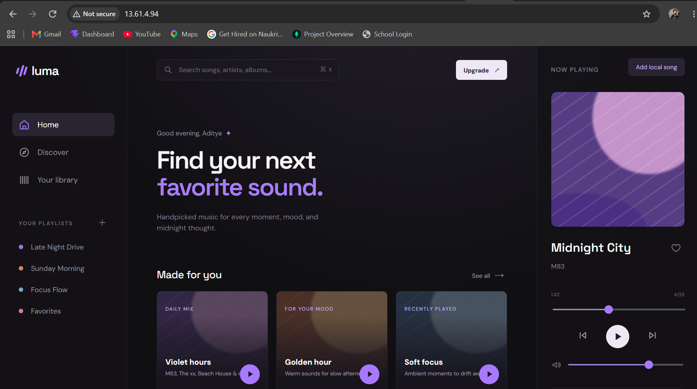

# 🎵 Luma Music Player

A modern full-stack music player built with **React, Vite, Node.js, Express, and SQLite**, deployed on an **AWS EC2 Ubuntu virtual machine** using Nginx and PM2.

## 🌐 Live Demo

**Deployment Platform:** AWS EC2 (Ubuntu)

**Deployment Status:** Temporarily Offline

> The application was deployed on an AWS EC2 instance.
> The instance is currently stopped to avoid unnecessary
> cloud costs. The live demo will be available again
> when the instance is restarted.

---

## 📸 Project Screenshots

### Music Player Dashboard


---

## ✨ Features

- Modern music player interface.
- Music library and track browsing.
- Playlist management.
- Liked songs.
- Playback state management.
- REST API using Express.js.
- Persistent data storage using SQLite.
- Production deployment on AWS EC2.
- Nginx reverse proxy and static frontend hosting.
- PM2 process management for backend availability.

---

## 🛠️ Tech Stack

| Technology | Purpose |
|---|---|
| React | Frontend UI |
| Vite | Frontend build tool |
| Node.js | Backend runtime |
| Express.js | REST API |
| SQLite | Database |
| better-sqlite3 | SQLite integration |
| Nginx | Web server and reverse proxy |
| PM2 | Backend process management |
| AWS EC2 | Cloud hosting |
| Ubuntu | Server operating system |

---

## 🏗️ System Architecture

```text
                  USERS
                    |
                    v
                 INTERNET
                    |
                    v
              AWS EC2 INSTANCE
                Ubuntu VM
                    |
                    v
                 NGINX :80
                    |
             +------+------+
             |             |
             v             v
       React Frontend   /api requests
        (dist folder)        |
                            v
                     Node.js + Express
                         PM2 :5000
                            |
                            v
                       SQLite DB
                      music.sqlite
```

**Deployment architecture:** Frontend and backend run on the same EC2 instance. Nginx serves the React production build and forwards API requests to the Express backend.

---

## 🗄️ Database Architecture

This project uses SQLite with `better-sqlite3`.

Database location:

```text
backend/data/music.sqlite
```

The database stores application data such as:

- Song metadata
- Playlists
- Playlist-track relationships
- Liked songs
- Playback state

SQLite stores data in a local database file on the EC2 instance's EBS-backed storage.

---

# 🚀 AWS EC2 Deployment Guide

## Step 1: Launch an EC2 Instance

1. Open AWS Management Console.
2. Navigate to EC2.
3. Launch an Ubuntu instance.
4. Create or select a key pair (`.pem`).
5. Configure the Security Group.

### Security Group Inbound Rules

| Type | Port | Source |
|---|---:|---|
| SSH | 22 | My IP |
| HTTP | 80 | 0.0.0.0/0 |

## Step 2: Connect to EC2 Using SSH

From your local terminal or WSL:

```bash
ssh -i ~/bbd.pem ubuntu@YOUR-EC2-PUBLIC-IP
```

**Why SSH?**

SSH (Secure Shell) provides encrypted remote access to the Ubuntu virtual machine. The `.pem` file authenticates your connection.

## Step 3: Update the Ubuntu Server

```bash
sudo apt update
sudo apt install -y nginx git
```

Install Node.js and npm using your chosen installation method.

Verify installation:

```bash
node -v
npm -v
git --version
```

## Step 4: Get the Project Code

Clone the repository:

```bash
git clone YOUR-GITHUB-REPOSITORY-URL
cd tutorialEC2
```

Project structure:

```text
tutorialEC2/
├── backend/
└── frontend/
```

## Step 5: Configure the Backend

Navigate to the backend directory:

```bash
cd backend
npm install
```

Install PM2 globally:

```bash
sudo npm install -g pm2
```

Start the backend:

```bash
pm2 start src/server.js --name luma-backend
```

Check the process:

```bash
pm2 status
```

Configure PM2 to restart the backend after an EC2 reboot:

```bash
pm2 startup
pm2 save
```

Follow the additional command printed by `pm2 startup`.

The backend runs on port `5000`.

## Step 6: Build the Frontend

Navigate to the frontend directory:

```bash
cd ~/tutorialEC2/frontend
npm install
npm run build
```

Vite generates the production build inside:

```text
frontend/dist/
```

Create the Nginx web directory and copy the production build:

```bash
sudo mkdir -p /var/www/luma
sudo cp -r dist/* /var/www/luma/
```

## Step 7: Configure Nginx

Open the Nginx configuration:

```bash
sudo nano /etc/nginx/sites-available/default
```

Example configuration:

```nginx
server {
    listen 80;
    server_name _;

    root /var/www/luma;
    index index.html;

    location / {
        try_files $uri $uri/ /index.html;
    }

    location /api/ {
        proxy_pass http://127.0.0.1:5000;
        proxy_http_version 1.1;

        proxy_set_header Host $host;
        proxy_set_header X-Real-IP $remote_addr;
        proxy_set_header X-Forwarded-For $proxy_add_x_forwarded_for;
        proxy_set_header X-Forwarded-Proto $scheme;
    }
}
```

Save the configuration and test it:

```bash
sudo nginx -t
```

Enable and restart Nginx:

```bash
sudo systemctl enable nginx
sudo systemctl restart nginx
```

## Step 8: Verify Deployment

Check Nginx:

```bash
sudo systemctl status nginx
```

Check backend:

```bash
pm2 status
```

Test the HTTP response:

```bash
curl -I http://localhost
```

Check listening ports:

```bash
sudo ss -tlnp
```

Open the application in your browser:

```text
http://YOUR-EC2-PUBLIC-IP
```

Your Luma Music Player is now accessible through the EC2 public IP.

---

## 🔐 Security Considerations

- Restrict SSH access to your own IP address.
- Keep backend port 5000 private.
- Expose HTTP port 80 publicly.
- Never commit private keys or credentials to GitHub.
- Store sensitive configuration in environment variables.
- Use HTTPS for production deployments.

---

## 🔄 Restarting the Application

If the EC2 instance is stopped and started again:

Check PM2:

```bash
pm2 status
```

Check Nginx:

```bash
sudo systemctl status nginx
```

If needed, restart services:

```bash
pm2 restart luma-backend
sudo systemctl restart nginx
```

**Important:** The public IPv4 address may change after stopping and starting an EC2 instance unless you use an Elastic IP.

SQLite data remains on the EBS-backed disk when the instance is stopped and restarted. Terminating the instance or deleting its storage requires separate data-protection considerations.

---

## 📚 What I Learned

Through this project, I gained practical experience with:

- Full-stack application development.
- REST API integration.
- SQLite database management.
- Linux server administration.
- AWS EC2 instance configuration.
- SSH-based remote server access.
- Nginx reverse proxy configuration.
- PM2 process management.
- Production frontend builds and deployment.
- Debugging server connectivity and browser access issues.

---

## 👨‍💻 Author

**Aditya Singh**

B.Tech Computer Science Engineering

GitHub: [Student-aditya123](https://github.com/Student-aditya123)

---

⭐ If you find this project interesting, consider giving the repository a star!
